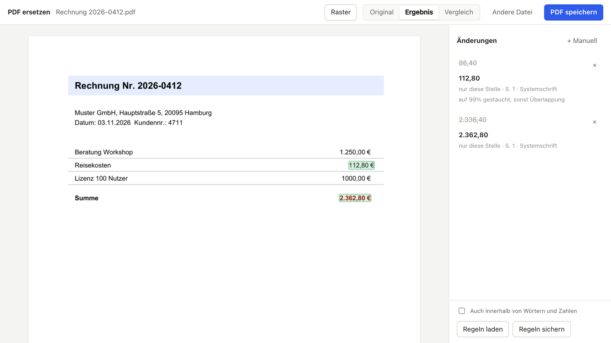

# pdf-ersetzen

Ersetzt einzelne Textstellen und Zahlen in maschinell erzeugten PDFs (Rechnungen, Angebote,
Exporte), ohne dass sich etwas verschiebt. Läuft lokal im Browser, das PDF verlässt den Rechner nicht.



## Warum sich in anderen Editoren alles verschiebt

Ein PDF kennt keine Absätze, sondern nur Zeichen an festen Koordinaten. Die meisten Editoren
rekonstruieren daraus Textblöcke, ersetzen den Block und setzen ihn neu, oft mit anderer Schrift,
anderer Laufweite und neuem Umbruch. pdf-ersetzen setzt nichts neu: Es entfernt nur die Zeichen der
Fundstelle und schreibt den neuen Text auf dieselbe Grundlinie, in derselben Schrift, Größe und
Farbe. Alles andere bleibt Byte für Byte unangetastet.

## Installation

Voraussetzung ist [uv](https://docs.astral.sh/uv/getting-started/installation/). Python lädt uv
bei Bedarf selbst.

```sh
uv tool install git+https://github.com/timoluehmann/pdf-ersetzen
```

Danach gibt es zwei Befehle: `pdf-ersetzen-ui` (Oberfläche) und `pdf-ersetzen` (Kommandozeile).
Aktualisieren mit `uv tool upgrade pdf-ersetzen`. Alternativ geht `pipx install git+https://…`.

## Oberfläche

```sh
pdf-ersetzen-ui
```

Startet einen Server auf `127.0.0.1` (Standardport 8765, sonst der nächste freie) und öffnet den
Browser. Beenden mit Ctrl+C.

- **Ersetzen:** PDF hineinziehen, Text anklicken (⇧-Klick erweitert auf mehrere Wörter), neuen
  Wert eintippen, Enter. Die Änderung gilt nur für genau diese Stelle. Das Häkchen „Überall im
  Dokument ersetzen“ schaltet auf alle Vorkommen.
- **Text einfügen:** Text anklicken, „Kopieren“, dann an die Zielstelle klicken, auch auf einer
  anderen Seite. Schrift, Größe, Farbe und Laufweite kommen von der Vorlage. Danach klicken zum
  Bearbeiten, ziehen zum Verschieben, Pfeiltasten für 0,5 pt (mit ⇧ 5 pt), ⌘V fügt dieselbe
  Vorlage erneut ein.
- **Einrasten:** Eingefügter Text rastet an Grundlinien (auch eine Zeile unter der letzten) und an
  linken oder rechten Spaltenkanten ein. Beträge aus rechtsbündigen Spalten werden rechtsbündig
  eingefügt. ⌥ beim Klicken oder Ziehen schaltet das Einrasten aus.
- **Raster** (Knopf oder Taste `R`): blendet Grundlinien, gemeinsame Spaltenkanten und ein
  5-mm-Kästchenraster ein. Eingefügter Text rastet dann auch auf das Kästchenraster.
- **Ansichten:** Original, Ergebnis, Vergleich. Taste `V` wechselt zwischen Original und Ergebnis.
- **Regeln sichern:** Ersetzungen lassen sich als `regeln.txt` sichern und wieder laden, im
  gleichen Format wie auf der Kommandozeile. Einfügungen werden nicht mitgesichert.

## Kommandozeile

```sh
pdf-ersetzen rechnung.pdf -r "86,40 € => 112,80 €" -r "Muster GmbH => Beispiel AG" --vorschau
pdf-ersetzen rechnung.pdf -f regeln.txt -o neu.pdf
```

Ohne `-o` entsteht `<name>_bearbeitet.pdf` neben dem Original. `--vorschau` legt PNGs vorher und
nachher an, `-s 1,3-4` beschränkt auf Seiten. Exit-Code 1, wenn eine Regel nichts gefunden hat.

Regeldatei: eine Regel pro Zeile, `#` für Kommentare.

```text
# ALT => NEU [| rechts | links] [| @Seite:x:y]
86,40 € => 112,80 €
Muster GmbH => Beispiel AG
1.336,40 € => 1.416,40 € | @1:494.8:176.2
```

Ohne Stellenangabe gilt eine Regel für jedes Vorkommen. Mit `@Seite:x:y` (PDF-Punkte, so schreibt
es die Oberfläche beim Sichern) nur für den Treffer an dieser Position. Regeln für eine Stelle
haben Vorrang vor Regeln für alle Vorkommen.

## Verhalten im Detail

- **Ganze Wörter und Zahlen:** `100` trifft nicht in `1000`. Mit `--teilstring` (bzw. dem Häkchen
  in der Oberfläche) abschaltbar.
- **Ausrichtung:** Rechtsbündige Spalten werden erkannt und behalten ihre rechte Kante.
- **Nachrücken:** Der Rest eines zusammenhängenden Textlaufs rückt mit, Spalten bleiben stehen.
- **Platz:** Passt der neue Text nicht in den freien Raum, wird er horizontal gestaucht. Unter 80 %
  gibt es eine Warnung.
- **Schrift:** zuerst die eingebettete Originalschrift, dann die gleichnamige installierte Schrift
  (auch aus Sammeldateien wie `Helvetica.ttc`), dann eine metrisch gleiche Schrift (Arial, Times
  New Roman, Courier New, unter Linux Liberation). Oberfläche und Kommandozeile zeigen, welche
  Schrift genommen wurde.
- **Kontrolle:** MuPDF verschiebt beim Entfernen von Zeichen teils den Rest einer Zeile. Danach
  wird deshalb jedes Zeichen der Seite gegen seine Originalposition geprüft und bei Bedarf exakt
  zurückgesetzt.

## Grenzen

- Kein Neuumbruch über Zeilen hinweg. Gedacht für einzelne Werte und kurze Textstellen.
- Gescannte PDFs (Bilder ohne Textebene) gehen nicht.
- Eingebettete Teilschriften ohne Unicode-Tabelle (häufig bei Word und Chrome) lassen sich nicht
  wiederverwenden. Ist die Schrift nicht installiert, kommt eine Ersatzschrift, das wird angezeigt.
- Eingefügter Text verdrängt nichts, Tabellenlinien werden nicht mitkopiert.
- Digitale Signaturen eines PDFs werden durch jede Änderung ungültig.

## Datenschutz

Der Server lauscht nur auf `127.0.0.1`. Hochgeladene PDFs liegen während der Sitzung in einem
temporären Ordner und werden beim Öffnen eines neuen PDFs oder beim Beenden gelöscht. Es gibt
keine Netzwerkzugriffe nach außen.

## Entwicklung

```sh
git clone https://github.com/timoluehmann/pdf-ersetzen
cd pdf-ersetzen
uv run pdf-ersetzen-ui     # Oberfläche aus dem Quellcode
scripts/verify.sh          # Tests
```

Aufbau: `src/pdf_ersetzen/kern.py` (Suchen, Schriftwahl, Ersetzen, Kommandozeile),
`oberflaeche.py` (HTTP-Server, nur Standardbibliothek), `ui/index.html` (Oberfläche als eine
Datei, ohne Build-Schritt). Einzige Abhängigkeit ist [PyMuPDF](https://pymupdf.readthedocs.io/).

## Lizenz

[AGPL-3.0-or-later](LICENSE). PyMuPDF steht unter der AGPL, deshalb gilt sie auch für dieses Projekt.
